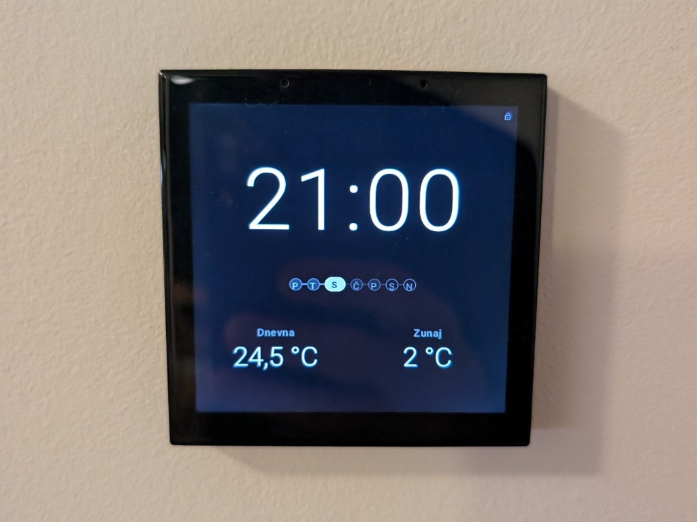
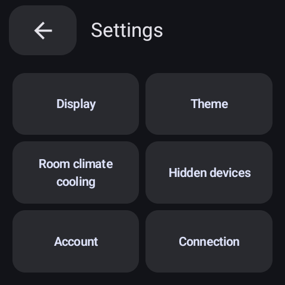
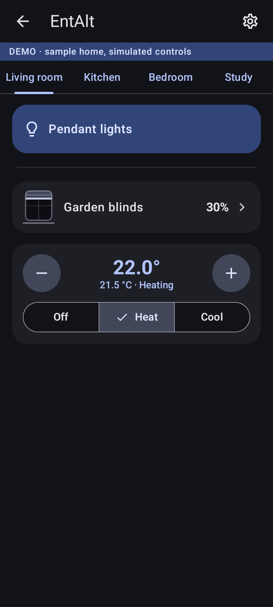
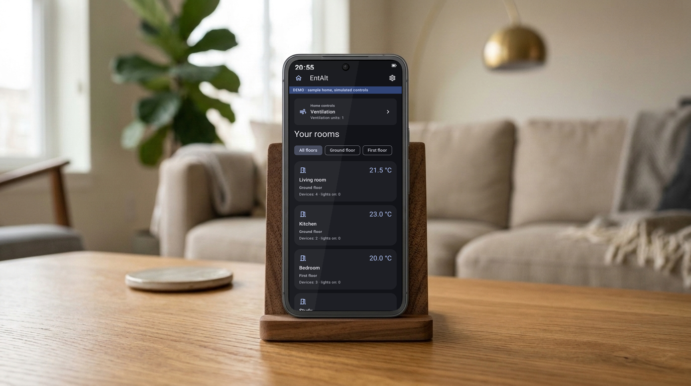

# EntAlt

EntAlt is an unofficial native Android client for **Entia** smart home systems, built as a hobby project using coding agents (mostly from the Gemini 4 family) and not affiliated with or endorsed by Entia (**use at your own risk**).

It works both as an app on Android phones and tablets and as a wall-mount unit app, where `1:1` (`480×480`) screens automatically switch to a dedicated clock-first screen (made for the wall-mounted unit used in **Židanov kvart**).

Automated unit and UI checks were written and run alongside development, and the app itself has been manually tested and confirmed working.

## Previews

| Wall-Mount Unit (`480×480`) | Wall-Mount Unit (Settings) |
| --- | --- |
|  |  |

| Pixel Phone (Room Controls) | Pixel Phone (Rooms Overview) |
| --- | --- |
|  |  |

## Installation & Sign-In

1. Download [`output/apk/EntAlt-0.13.0-optimized.apk`](output/apk/EntAlt-0.13.0-optimized.apk) (Android 8.0 / API 26+, R8-minified, development-signed; SHA-256 in [`output/apk/EntAlt-0.13.0-optimized.apk.sha256`](output/apk/EntAlt-0.13.0-optimized.apk.sha256): `258af36f56d1ce4ccb77c7515c17e2029aeb9c4ac85fb79d9007c758365c160c`).
2. Install it directly on your Android device or wall-mounted unit (allow installs from unknown sources if prompted), or install over ADB:
   ```sh
   adb install -r output/apk/EntAlt-0.13.0-optimized.apk
   ```
3. Launch EntAlt and sign in using the **username and password assigned to you by Entia** (or choose **Explore the demo home** to preview the interface offline).

> [!TIP]
> To transfer the `.apk` file wirelessly to the wall-mounted unit, you can use the **Send files to TV** app from the Google Play Store.

## Features

- **Android Phone, Tablet & Widget**:
  - Per-room controls for lights, blinds (top-down slider with presets), climate (target temperature and mode, with optional **Hide Cool mode**), and whole-home HRV ventilation.
  - Encrypted credential storage via Android Keystore (`AES/GCM/NoPadding`) with automatic token renewal.
  - Local **Philips Hue** Bridge (CLIP v2) pairing to link bulbs/rooms/zones to Entia switches (preserving sibling bulb states on shared outlets) or add standalone Hue lights.
  - Responsive home-screen widget that adapts to resized launcher dimensions (`1×1` up to `4×3+`).
  - English and Slovenian UI (`System`, `English`, or `Slovenščina` in Settings).
- **Special `480×480` Wall-Mount Screen**:
  - Ambient dark clock face (`HH:mm`), week progress slider, and large indoor/outdoor temperatures.
  - Fixed-position bottom **Heating rooms bar** highlighting actively heating rooms (red background, black text), toggleable in **Settings**.
  - Optional **Panel child lock** in **Settings** requiring a 1.5-second hold on the clock face to unlock controls.

## Repository Structure

```text
.
├── android/     # Native Android Gradle project (Kotlin)
├── docs/        # Architecture plan, checkpoint notes, and legacy Swagger docs
├── output/apk/  # Packaged optimized APK and SHA-256 checksum
├── scripts/     # Local build and verification helper scripts
└── store/       # App icon and feature graphic assets
```

## Building from Source

Open `android/` in Android Studio or build with Android SDK 36 and JDK 17+:

```sh
cd android
./gradlew :app:testDebugUnitTest :app:testOptimizedUnitTest :app:assembleDebug :app:assembleOptimized :app:lintDebug :app:lintOptimized
```

- Debug APK: `android/app/build/outputs/apk/debug/app-debug.apk`
- Optimized APK: `android/app/build/outputs/apk/optimized/app-optimized.apk`

## Acknowledgements & Sources

- **[HomeAssistant-Entia](https://github.com/dsoklic/HomeAssistant-Entia)** by `@dsoklic`: primary protocol reference for authentication, `/flat` and `/flat/device` snapshots, `/rt` writes, WebSocket events, and device/attribute mappings.
- **Entia API V1 Documentation** (`https://api.entia.si/doc/`, archived snapshot in [`docs/api/entia/`](docs/api/entia/)): supplementary REST schema reference.
- **Philips Hue CLIP API v2**: local Hue Bridge discovery and HTTPS control.

## Security Notes

Credentials, Hue application keys, and signing keystores are never committed to source control.
