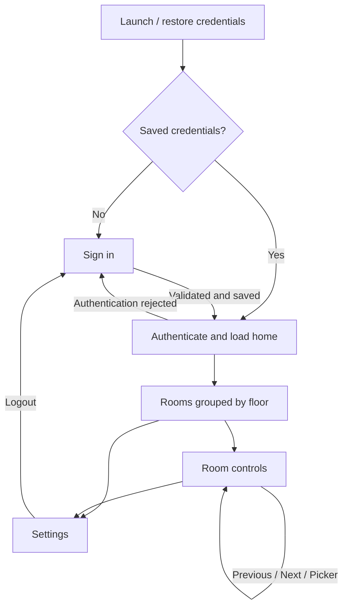

# Entia Android application implementation plan

Prepared: 2026-11-16. Source reviewed: the local integration in `reference/home-assistant-entia/` (originally `HomeAssistant-Entia-main/`), its tests/documentation, and the user-saved Entia API V1 Swagger/OpenAPI specification in `docs/api/entia/`.

**Source precedence:** per the user's instruction, the proven integration and its accompanying documentation take precedence when sources disagree. Swagger is supplementary and may be outdated. Implement the working login, endpoints, value mappings, and refresh behavior first; Swagger-only functionality requires verification before becoming an application dependency.

## 2026-11-16 implementation updates

The user's later requirements refine the initial plan:

- Display only devices with a usable status or supported action, and rooms containing such devices.
- Present ventilation under home controls, separately from room HMI heating. The working integration addresses each HRV unit by device ID; preserve multiple discovered units rather than assuming one endpoint for every installation.
- Use compact light/sensor tiles and solid, filled Previous/Next navigation.
- Restore the clock-first always-on face with weekday/date beneath and secondary temperatures. Compact controls use fixed room/device navigation and finite menus instead of scrolling tall phone cards. Its tap menu exposes climate, ventilation, Rooms and Settings. All normal navigation screens offer a labeled Clock return action. Prioritize climate/readings before lights; retain access to other supported rooms.
- Support local-only device names, hidden-device restoration, and six light icon choices through long-press editing. Scope these settings to the account/device and preserve server metadata.
- Keep socket diagnostics in Connection; ordinary disconnections should not dominate the interface or imply that an open socket guarantees freshness.
- Include a selectable Clock/Room temperature focus in the full-screen Room display for a tiny 4:3 wall panel: large measured indoor temperature, clock, weekday and Entia outdoor temperature 1104. Automatically prefer Dnevna/Living room and provide an explicit room picker. Missing readings remain unknown. Source previews target 320×240 and 240×180 dp; actual hardware resolution/density is unknown.
- Require explicit unofficial-app/own-risk agreement once per installation, saved before restoring credentials or creating an API client. Preserve acceptance across sign-out and app updates.

## 1. Intended application

Build a native Kotlin Android application that connects directly to Entia, remembers the user's credentials securely, and presents the home as floors and rooms. Users can move from room to room and control the devices available in each room through Material Design 3 screens adapted for phones, tablets, and small Android wall panels.

The application will use the Entia cloud endpoints already exercised by the integration. A running Home Assistant server is not required. Port the protocol and device behavior into Kotlin; Home Assistant entity classes and the Python runtime are not part of the Android application.

Initial scope:

- Sign in with an Entia username/email and password; retain credentials across application restarts and device reboots until logout or application data removal.
- Discover floors, rooms, device labels, and current device attributes.
- Navigate through a room list, a room picker, and Previous/Next room actions.
- Support lights, blind position and derived tilt, room climate, ventilation, and temperature readings.
- Receive WebSocket updates and reconcile state using REST snapshots.
- Show connection status, pending commands, and actionable errors. Show devices only when they offer a supported status reading or action; show rooms only when they contain at least one such device (user update, 2026-11-16).
- Provide account settings, credential replacement, and local logout.
- Deliver intentional compact-panel, phone, and tablet layouts, including short landscape windows and square wall displays. Small panels are a first-release target, not a later styling exercise.

Start with one account and the flat returned for that account. Multi-account management, selecting between multiple flats, schedules, scenes, notifications, widgets, and control while the app is closed are later extensions. Swagger documents additional account/notification/extended-data operations and scene/schedule schemas, but the supplied integration does not implement those features.

## 2. Findings from the supplied code

| Evidence | What it establishes | Android implication |
| --- | --- | --- |
| [api.py](../reference/home-assistant-entia/custom_components/entia/api.py), `EntiaApiClient` | Login, bearer authentication, two snapshot endpoints, attribute writes, and one reauthentication attempt on HTTP 401 | Implement a small API client and a shared session manager |
| [config_flow.py](../reference/home-assistant-entia/custom_components/entia/config_flow.py), `async_step_user` | Username/password setup validates login and `/flat`; account identity is the username | Validate credentials before saving; do not require a flat ID/name |
| [coordinator.py](../reference/home-assistant-entia/custom_components/entia/coordinator.py), `_build_label_map`, `_async_update_data` | Hierarchy comes from `/flat`; device state comes from `/flat/device`; labels contain HTML entities; REST refresh is every five minutes | Preserve the room hierarchy rather than reducing it to a device label map |
| [client/ws_client.py](../reference/home-assistant-entia/custom_components/entia/client/ws_client.py) | Token in the WebSocket URL, no subscription message, 30-second heartbeat, reconnect delay of 2–300 seconds | One shared socket for the signed-in foreground session |
| [const.py](../reference/home-assistant-entia/custom_components/entia/const.py), [light.py](../reference/home-assistant-entia/custom_components/entia/light.py), [cover.py](../reference/home-assistant-entia/custom_components/entia/cover.py), [climate.py](../reference/home-assistant-entia/custom_components/entia/climate.py), [sensor.py](../reference/home-assistant-entia/custom_components/entia/sensor.py) | Attribute-based capabilities, raw value conversions, and supported commands | Centralize mappings and conversions outside composables |
| [tests/entia](../reference/home-assistant-entia/tests/entia) | Expected light, cover, temperature, HVAC, ventilation, and sign-in behavior | Translate useful behavior cases into Kotlin tests |
| [CLAUDE.md](../reference/home-assistant-entia/CLAUDE.md) | Documented sample response shapes, additional observed attributes, and protocol caveats | Treat examples as observed shapes, not a complete published schema |
| [Saved OpenAPI specification](api/entia/openapi.json) and [snapshot notes](api/entia/README.md) | Entia API V1, OpenAPI 3.0.0; supplemental REST models and additional endpoint descriptions | Record potential differences; proven integration behavior wins over conflicting or unverified Swagger claims |

Workspace finding: there is currently no Android Gradle project, manifest, Kotlin source, or app module. Existing IDE metadata includes a Python module. Project scaffolding is therefore the first implementation task, even though the work is being planned for Android Studio.

Important differences between documented intent and current implementation:

- Swagger documents `flat.id` and the state envelope's `id`, but the integration examples omit these IDs. Retain optional IDs when present; no flat name is guaranteed.
- The coordinator discards floors, rooms, timestamps, `connected`, and `timezone`. The Android repository should retain these where present.
- The socket parser forwards only device ID, attribute ID, and raw value. Android should also retain the optional timestamp to improve reconciliation.
- The socket reconnect loop retrieves the cached token; it does not explicitly refresh a rejected WebSocket token. Android needs bounded recovery through the session manager.
- Device capability detection uses attribute presence, not a single device type. A device may expose multiple capabilities.

### Reconciliation with the saved Swagger specification

The local [API reference snapshot](api/entia/README.md) contains both a readable Swagger page and an extracted `openapi.json`. The full specification was extracted from `swagger-ui-init.js` without executing the script. Use the working integration and its notes as the primary protocol contract. Consult Swagger for supplemental shapes and possible future features; retain tolerant parsing where it differs from observed payloads.

| Specification finding | Required decision |
| --- | --- |
| Global security lists bearer authentication OR API-key authentication; `/login` declares an `X-API-KEY` header | Follow the proven keyless username/password login by default. Do not add a required API-key field or block implementation based on this conflicting Swagger declaration |
| `/rt` is marked experimental; its prose says status-only response, while its response schema references `AttributeSetting` | Keep the proven `/rt` write and post-write snapshot refresh; allow response variations without assuming the response proves physical completion |
| `/flat/device` mentions a `flat_connection` WebSocket event | Treat as an optional enhancement if observed; verify its payload and keep initial connectivity based on the proven snapshots |
| Swagger lists `GET /flat/device/{deviceId}/attribute/{attributeId}` | Consider targeted reads only after verification; they are not required for first-release command confirmation |
| `GET /flat/config` includes capability/range/access schemas but is marked NOT IMPLEMENTED | Do not depend on runtime capability metadata for the initial UI |
| Floor IDs are absent; flat IDs and additional room/device metadata are documented | Preserve optional metadata and keep robust room-ID navigation |
| Query strings occur inside path keys; some schema/response definitions are incomplete | Handwrite the small client/DTO set; preserve the original spec and avoid unchecked code generation |

The API-key declaration is recorded as a likely documentation mismatch, not an implementation prerequisite. The supplied client already authenticates without that header; preserve that behavior. Investigate key provisioning only if actual deployment behavior demonstrates it is necessary. Any such future key must have a defined provisioning model; a confidential key cannot be protected merely by embedding it in an APK.

## 3. Android project and architecture

Create a self-contained Gradle project under `android/` and open that directory as the Android Studio project. Reference Python code is in `reference/home-assistant-entia/`; planning and API documentation are in `docs/`. See the [workspace README](../README.md) for the current layout.

Use Kotlin, an Empty Activity Compose application, Gradle Kotlin DSL, a version catalog, and a committed Gradle wrapper. Proposed `minSdk` is 26, subject to checking the actual wall panels' Android versions before locking support. Select compatible stable compile/target SDK, Android Gradle Plugin, Kotlin, and JDK versions using the installed Android Studio toolchain when scaffolding. Record the resolved versions rather than relying on dynamic dependency versions.

| Concern | Planned choice |
| --- | --- |
| UI | Jetpack Compose and Material 3, with stable Compose BOM-managed UI dependencies |
| Adaptive layout | Available window width and height in dp, Material adaptive layouts, and a dedicated compact panel presentation |
| Navigation | Jetpack Navigation Compose with typed destinations carrying IDs |
| State | Screen ViewModels, coroutines, immutable `StateFlow`, lifecycle-aware collection |
| Network | OkHttp for HTTPS and WebSocket; cancellable suspending REST calls |
| JSON | Kotlin serialization DTOs; tolerate unknown fields and explicitly validate required structures |
| Credentials | Android Keystore AES key plus an encrypted private file |
| Preferences | Preferences DataStore for theme, layout preference, preferred startup/last room, and remembered ventilation speed |
| Dependencies | Constructor injection and a small application-scoped container |
| Tests | JUnit, coroutine tests, MockWebServer, and Compose UI/instrumentation tests |

The ViewModel/repository structure and lifecycle-aware flow collection follow [Android's architecture recommendations](https://developer.android.com/topic/architecture/recommendations). Navigation should carry room/device identifiers and resolve their data from the repository; see [Android navigation guidance](https://developer.android.com/guide/navigation/use-graph/navigate).

Suggested structure, using `com.example.entapp` as a replaceable development namespace:

```text
android/
  settings.gradle.kts
  build.gradle.kts
  gradle/libs.versions.toml
  gradlew / gradlew.bat / gradle/wrapper/
  app/
    build.gradle.kts
    src/main/AndroidManifest.xml
    src/main/java/com/example/entapp/
      EntiaApplication.kt
      MainActivity.kt
      di/AppContainer.kt
      data/auth/SessionManager.kt
      data/remote/ClientIdentity.kt
      data/local/CredentialStore.kt
      data/local/PreferencesStore.kt
      data/remote/EntiaApi.kt
      data/remote/EntiaWebSocket.kt
      data/remote/dto/
      data/repository/EntiaRepository.kt
      domain/model/
      domain/DeviceCapabilities.kt
      domain/AttributeCodec.kt
      domain/BlindTiltState.kt
      ui/navigation/
      ui/login/
      ui/rooms/
      ui/room/
      ui/settings/
      ui/components/
      ui/theme/
    src/test/
    src/androidTest/
```

Keep one app module initially. Use `INTERNET` and `ACCESS_NETWORK_STATE` manifest permissions, HTTPS/WSS with normal certificate validation, and cleartext traffic disabled. These cloud APIs do not require location or local-network discovery permissions. Keep secrets and local SDK paths out of source control.

## 4. API contract to implement

### REST and authentication

Base URL: `https://api.entia.si/`. Swagger also lists `http://localhost:8083`; that development server is not an Android production default.

| Operation | Method and path | Request/response |
| --- | --- | --- |
| Sign in | `POST /login` | Username/password/client metadata; response `token`; no API-key header in the proven implementation |
| Discover hierarchy | `GET /flat` | Nested `flat.floors[].rooms[].devices[]` |
| Read all states | `GET /flat/device` | `FlatState`: optional `id`, `connected`, `timezone`, `devices`, and account data; integration also tolerates a bare device array |
| Set an attribute | `PUT /flat/device/{deviceId}/attribute/{attributeId}/rt` | Integer `{ "value": <raw value> }`; realtime experimental variant, state confirmed separately |
| Confirm one attribute (Swagger-only, optional) | `GET /flat/device/{deviceId}/attribute/{attributeId}` | Candidate targeted read; verify before enabling, otherwise use proven bulk refresh |
| Standard attribute write (Swagger-only, later) | `PUT /flat/device/{deviceId}/attribute/{attributeId}` | Possible alternate transport, not an automatic retry/fallback |
| Extended device data (Swagger-only, later) | `GET /flat/device?data=1`, `GET /flat/device/{deviceId}?data=1` | Possible extended state/data; verify availability and encode `data=1` as a query parameter |

After login use `Authorization: Bearer <token>` for parity with the integration. Login sends no `X-API-KEY` in the default implementation. Swagger's API-key declaration conflicts with this working client and must not create a new login dependency. Its global alternatives are OR, not a requirement to send both headers. If an API key is ever introduced following verified live requirements, redact it and distinguish configuration errors from bad credentials.

Preserve `/rt` for the control path used successfully by the integration. Download bulk snapshots and group locally for room navigation; post-write bulk refresh plus WebSocket updates is the initial confirmation mechanism. Swagger-only single-attribute reads may be added after verification. Attribute and setting endpoints are distinct: do not route normal device controls through settings. Primary contracts come from [api.py](../reference/home-assistant-entia/custom_components/entia/api.py) and the local [API notes](../reference/home-assistant-entia/CLAUDE.md); [OpenAPI](api/entia/openapi.json) is supplementary.

The known-working login body in the integration is:

```json
{
  "username": "user@example.com",
  "password": "<entered password>",
  "platform": "home_assistant",
  "device_model": "home_assistant",
  "device_serial": "0000"
}
```

Swagger's `Creds` schema also lists these five string properties but specifies no allowed platform values. Keep metadata in an isolated client-identity configuration and initially use the integration's proven values. Verify Android-specific values before changing them. If a serial is required later, prefer an app-generated installation identifier over hardware identifiers. No API-key field/header is added on Swagger's authority alone. No live credentials or keys are included in this plan.

Example hierarchy, abbreviated from the supplied notes:

```json
{
  "flat": {
    "floors": [{
      "rooms": [{
        "id": 2978,
        "label": "Dnevna",
        "devices": [{"id": 42467, "label": "1.1 dnevna", "type": 4}]
      }]
    }]
  }
}
```

Example state envelope:

```json
{
  "connected": 1,
  "timezone": "Europe/Ljubljana",
  "devices": [{
    "id": 42467,
    "device_type_id": 400,
    "room_id": 2978,
    "attributes": [{"id": 401, "timestamp": 1780034143, "value": 0}],
    "settings": []
  }]
}
```

Treat IDs as normalized `Long` values, including integral numeric forms and numeric-string IDs if encountered; reject fractional IDs. Swagger inconsistently uses `number` versus `integer` for identifiers. `AttributeSetting.value` and `SetAttributeSetting.value` are documented integers: serialize the supported control values as integers and validate incoming values in capability codecs. Keep raw JSON for diagnostics/unknown future capabilities; missing, null, malformed, or unknown values become unavailable/unknown rather than zero. Unknown JSON fields should not break otherwise valid responses. Distinguish an empty device list from a malformed response.

For `/rt`, Swagger's prose says the response carries status without attribute state, contradicting its `AttributeSetting` response-schema reference. Parse status defensively, tolerate an empty success body for compatibility, and confirm state through events or the attribute GET/snapshot. HTTP success alone is not evidence that physical movement finished.

### Session recovery

Implement a shared `SessionManager`, rather than making every screen authenticate independently:

1. Obtain a token when the session has none.
2. On an authenticated REST HTTP 401, perform one shared login using the saved credentials and retry that request once.
3. Serialize login with a mutex and compare the token/session generation so simultaneous failures do not trigger repeated logins.
4. A second 401, or login 401/403, enters `NeedsSignIn`; pause polling/reconnect loops and show the sign-in screen, following the integration's proven behavior. An authenticated endpoint's 403 is a permission error, not an automatic password retry. If live behavior later identifies a distinct client-configuration failure, represent that separately rather than repeatedly requesting the password.
5. DNS, timeout, offline, rate-limit, server, and parsing errors retain saved credentials and show their appropriate recoverable states. Use bounded retries/backoff and honor `Retry-After` where supplied.

Neither the integration nor this Swagger snapshot exposes refresh-token, server logout, or token-revocation operations. Renew sessions through `/login`; logout is local. Swagger does document `/user/password` and administrative account endpoints, while `/user/password/reset` is explicitly NOT IMPLEMENTED. Those server account-management operations are outside the initial app; replacing locally saved credentials does not change the server password. Keep login requests outside any authenticated-request retry path to avoid recursion.

## 5. Persistent credentials and account lifecycle

Persistence is the default behavior: the sign-in screen states that the account will remain signed in on this device. Keep the bearer token in memory; after process death or reboot, silently authenticate again with the encrypted saved credentials.

Use a narrow `CredentialStore` abstraction with `save`, `load`, and `clear` operations:

- Generate a non-exportable AES-256 key in Android Keystore. Encrypt the username/password record with `AES/GCM/NoPadding`, a fresh IV for each encryption, and a versioned file format containing IV and authenticated ciphertext. Keystore holds the key, not the credential text; see the [Keystore documentation](https://developer.android.com/privacy-and-security/keystore).
- Write ciphertext atomically to `Context.noBackupFilesDir`. Keep credentials out of ordinary DataStore, plain preferences, databases, logs, analytics, crash reports, intent extras, Compose `rememberSaveable`, and `SavedStateHandle`.
- Explicitly account for cloud backup and device transfer in backup configuration; verify the encrypted credential file never migrates independently of its device key. Review [Android's backup behavior](https://developer.android.com/identity/data/autobackup) during implementation.
- Do not require biometric authentication for each key use in the initial version, so silent sign-in works as requested. A separate optional app lock can be added later.
- Use platform cryptography behind the store abstraction. Android documents `security-crypto` APIs as deprecated, so do not base a new implementation on `EncryptedSharedPreferences`; see [Android cryptography guidance](https://developer.android.com/privacy-and-security/cryptography).
- On an unreadable record or invalidated/missing key, clear the unusable record and request sign-in with a concise explanation. On a storage failure after successful validation, report that persistence failed rather than claiming the account was saved.

First sign-in: reject blank fields, trim surrounding username whitespace, preserve password exactly, then call `/login` and `/flat` as the source setup does. Persist only after validation succeeds. Load `/flat/device` next; if that request temporarily fails, retain the validated account and offer retry. Do not impose an email-only validator because the protocol field is `username`.

Credential replacement: validate the new credentials in an isolated candidate session. Replace the stored record only after validation and a successful atomic save, then switch session generation, discard the old account's state, and reload. A failed replacement preserves the working session.

Logout: invalidate the session generation first; cancel in-flight calls, polling, socket, and reconnect jobs; clear the token, encrypted file, key alias, device state, and account-scoped room/speed preferences; reset navigation to sign-in. Ignore late results belonging to the old generation. This is the app's local “forget this account” action.

## 6. Home hierarchy and repository models

Create separate wire DTOs and UI/domain models:

- `Home`: account-local identity, optional server flat ID from either snapshot, floors, rooms, device map, optional connection/timezone/city metadata, and last successful sync time. Keep account-local identity as the fallback when server IDs are absent.
- `Floor`: optional server ID/label, source order, and room IDs.
- `Room`: server ID, decoded label, optional type, parent floor, source order, device IDs, and optional scene metadata retained for later use.
- `Device`: server ID, decoded label, optional type/subtype/`isFlatDevice` metadata and telemetry `room_id`, capability set, attributes keyed by attribute ID, and separately retained settings.
- `AttributeState`: raw value, optional server timestamp, receive sequence, and source.
- `ConnectionState`: initial loading, live, REST fallback, reconnecting, offline, or needs sign-in; track home/controller connectivity separately from socket connectivity.
- `CommandState`: idle, sending, awaiting observed state, confirmed, failed, or outcome unknown; keyed by device/attribute.

Mapping rules:

1. Preserve all floors and rooms from `/flat`, including empty rooms, in the domain snapshot. In the UI, hide rooms with no devices offering supported readings/actions. Decode HTML entities in labels as plain text, including Slovenian characters; do not render arbitrary label markup.
2. Build device-to-room membership from the hierarchy and join states by device ID. A valid `room_id` can place an otherwise unmatched state device into a known room; remaining devices appear under “Unassigned devices.”
3. If hierarchy membership and telemetry `room_id` disagree, refresh metadata and retain the discrepancy internally. Use the hierarchy for navigation and only unambiguous telemetry room IDs for valve matching; do not guess a valve association from display placement.
4. Allow missing floor IDs/labels. Use “Floor 1”, “Floor 2”, etc. and transient source-order keys when no stable floor ID exists. Restore navigation by room ID, not by an invented stable floor key. Missing labels fall back to “Room {id}” or “Device {id}”.
5. Use attribute-based capability detection and validate readings. Display only cards with a supported status reading or action. Keep unsupported/unavailable records in the domain for reconciliation and climate valve matching, and omit their placeholder rows from the UI. A device with a valid read-only temperature remains visible.
6. A hierarchy device without state remains visible but unavailable. A successful refresh that removes a device disables its controls; a failed refresh keeps the last snapshot marked stale.
7. Persist only credentials and small preferences initially. Device snapshots live in repository memory; after process death, reload them from Entia. A persistent offline snapshot database is optional later work.
8. Keep documented `isFlatDevice` metadata without assuming its exact grouping semantics. If live data confirms a shared home device, show it in a common/home-devices group rather than forcing an arbitrary room. Preserve server permissions: account/room/device restrictions may reduce visible data or reject writes; never infer access from a cached device list alone.

## 7. Device behavior and exact conversions

The following table comes from [const.py](../reference/home-assistant-entia/custom_components/entia/const.py) and the entity implementations. Swagger describes generic integer attribute values but does not enumerate these numeric attribute meanings or temperature scales. Detection means attribute presence; a null value still requires an unavailable state. Its optional configuration schemas include `min_value`, `max_value`, `invalid_value`, `enabled`, and access/writability flags, but `/flat/config` is marked NOT IMPLEMENTED, so the initial app cannot depend on fetching those flags.

| Capability | Detection/read attributes | Write behavior and UI |
| --- | --- | --- |
| Light | `401` | Switch writes `401 = 1` for on, `0` for off. No brightness/color controls are established |
| Blind position | `601`; movement indicator `603` when present | API `0 = open`, `100 = closed`. UI displays percent open: `100 - raw`; write `100 - percentOpen`. Open writes `0`, Close writes `100` |
| Blind tilt | Derived from the blind's position/direction | Small writes to `601`, described below; no dedicated tilt attribute |
| Temperature sensor | `801` | Read-only Celsius = raw / 2.0 |
| Room climate | Both `1103` and `1105` | Current = `1103 / 2.0`; target = `1105 / 2.0`. Set target through `1105`, raw = `round(celsius * 2)` |
| HVAC mode | `1107` on a climate controller | `0 = off`, `1 = cool`, `2 = heat`. Display only controls supported by present attributes |
| Heating/cooling activity | `2101` on a device with the same telemetry `room_id` | Read-only valve indication: `1 = active`, `0 = idle`, interpreted according to HVAC mode |
| Ventilation speed | `3702` | `0 = off`, `1 = low`, `2 = medium`, `3 = high` |
| Ventilation preset | `3701` on ventilation device | `0 = bypass/pass-through`, `1 = heat recovery` |

Climate details:

- Expose the source's target range of 10–30 °C in 0.5 °C steps. Validate the range/step before sending; for example, 21.5 °C writes `{ "value": 43 }` to attribute `1105`.
- Keep the setpoint as integer half-degree steps internally to avoid floating-point rounding ambiguity.
- Prefer the same-room valve over temperature comparison. If no valid valve exists, heat is estimated active when current < target, cool when current > target; label that status as estimated. Off remains off regardless of valve state. Missing data or ambiguous multiple valve devices produce unknown activity rather than a cross-room guess.
- Match the source's convenience power behavior: turning room climate on selects Heat; turning it off selects Off. Keep Off/Heat/Cool explicit in the UI.
- Attribute `1104` is documented as outside temperature, raw / 2, but is not exposed by the Python entities. It can be an optional read-only enhancement after confirming live data.
- Attribute `1106` is documented with an unconfirmed fan-speed mapping. Do not expose write controls for it.

Ventilation details:

- Present each discovered ventilation unit under home controls with power, speed, and preset; it has no room-temperature setpoint. It is separate from per-room HMI heating. The protocol does not establish that every installation has exactly one unit.
- Selecting Low/Medium/High writes `3702` and also turns the unit on. Power off writes `0`; power on restores the last observed nonzero speed, defaulting to Low.
- Store the remembered speed by account and device ID. Changing bypass/heat recovery writes only `3701` and must not implicitly change power.

Blind tilt needs a dedicated state machine, ported from [cover.py](../reference/home-assistant-entia/custom_components/entia/cover.py):

```text
offset = roundHalfToEven(tiltPercent / 100.0 * 3)
direction = -1 if the last position move was downward, otherwise +1
writeValue = clamp(baseRawPosition + direction * offset, 0, 100)
write attribute 601 with writeValue
```

- Python `round` uses ties-to-even; choose an explicit equivalent in Kotlin, not a rounding helper with different tie behavior. At 50% tilt, `round(1.5)` produces 2 units.
- Track base position, last movement direction, pending commanded raw value, and derived tilt per device. A position command resets derived tilt and updates direction; a tilt command does not move the stored base.
- While `603` reports moving, defer external-position tilt reconciliation. An idle value matching the pending command confirms that command. Other idle updates within the signed 0–3 unit offset derive tilt; larger changes establish a new base and direction.
- The source initializes direction to downward and tilt to zero. At cold start Android should represent tilt as unknown/estimated and enable tilt after a position command establishes direction. Do not present an inferred value as a measured slat angle.
- Disable concurrent position/tilt commands while that blind is awaiting reconciliation. There is no confirmed Stop command; do not add one.
- Attribute `602` is documented as mirroring position during movement; retain it if received, but do not make it a separate writable control.

## 8. Material Design 3 screens and room navigation

Use Compose Material 3 theming, light/dark schemes, and optional dynamic color on Android 12+ with a fixed palette fallback, as described in [Material 3 for Compose](https://developer.android.com/develop/ui/compose/designsystems/material3). Use standard components and readable device states throughout.

### Visual direction and adaptive layouts

Aim for a calm home-control interface: a restrained teal primary palette, warm neutral surfaces, clear room headings, generous spacing, and readable temperature numerals. Use semantic Material color roles for active controls and state, 8 dp spacing increments, consistent 16–20 dp card corners, restrained elevation, and short purposeful transitions. Keep content widths bounded on large screens; avoid stretching a phone card across an entire tablet. Preserve the same visual identity on all layouts.

Choose layouts from the actual available app window in dp after insets, not device names, diagonal inches, or raw pixel resolution. Reevaluate on rotation, resizing, keyboard appearance, and split screen. Android classifies available width and height independently; short landscape windows need explicit consideration alongside width, as explained in [window size class guidance](https://developer.android.com/develop/ui/compose/layouts/adaptive/use-window-size-classes).

The following are application layout rules, with exact thresholds adjustable after rendering on target panels:

| Available window | Presentation | Design requirements |
| --- | --- | --- |
| Very small/short: width < 320 dp or height < 360 dp, or user-selected compact panel layout | Single room and one device/capability section at a time; dedicated full-screen room/device pickers | Compact room header, large essential values, Previous/Next actions, scrollable controls; no permanent navigation rail, crowded dashboard, or partial-height dialog |
| Compact width < 600 dp with enough height | Phone layout: Rooms list/grid then Room screen; one column of device cards | Comfortable one-handed controls, visible current room, scroll restoration, keyboard-safe sign-in |
| Medium width 600–839 dp with height >= 480 dp | Two-column room grid; room details use a bounded responsive control grid where cards fit | Use space without forcing a narrow detail pane or oversized sliders |
| Width >= 840 dp and height >= 480 dp | Tablet list-detail: floor/room list beside room controls, with one or two control columns | Room pane roughly 240–320 dp; detail pane at least 360 dp; cap overall content around 1440 dp and preserve breathing room |
| Wide but short window | Single pane/compact controls according to available height | Do not choose tablet panes solely because the window is wide; all content remains reachable by scrolling |

Small wall panels must remain attractive and operable without shrinking controls:

- Offer Auto and Compact panel layout preferences plus a preferred startup room, useful for a panel mounted in that room. Default to automatic adaptation; do not lock device orientation.
- Keep the room name/picker and primary command easy to find. Page or scroll between device sections and use full-screen pickers when a full room dashboard will not fit.
- Use large on/off controls and temperature +/- buttons; provide a focused full-screen editor for blind position/tilt or mode selection if the normal card would crowd. Keep a numeric value visible while editing.
- Target at least 48 × 48 dp for every interactive element and prefer 56–64 dp for the principal wall-panel actions where space permits. Gain room by reducing decorative spacing or showing fewer items, not by reducing touch targets. See [Compose accessibility defaults](https://developer.android.com/develop/ui/compose/accessibility/api-defaults).
- Make sign-in vertically scrollable with the focused field and submit action reachable above the on-screen keyboard; username/password entry cannot assume a phone-sized portrait window. Do not persist password form state.
- Keep connection/error status concise; show detailed errors in a separate screen rather than consuming the entire control surface. Long room names can use an abbreviated header with the full name available in the picker.
- Use efficient lazy lists, stable component keys, and modest animation for lower-powered Android panels. Show last-known state and offline status immediately on return.
- Keep navigation and account settings reachable without relying on hardware Back buttons, edge swipes, or a software system navigation bar being visible. Compact panel mode is a presentation setting; OS kiosk/device-owner management is separate future scope.

Authentication forms should be centered with a maximum width around 420 dp on tablets and remain full-width/scrollable on panels. Do not make permission, authentication, or connection flows depend on the chosen layout. Layout changes preserve the selected room, drafts other than passwords, and pending device commands; they never create a new network session.

Navigation flow:



| Screen | Material components and behavior |
| --- | --- |
| Sign in | `OutlinedTextField` for username and masked password, visibility toggle, password-manager/autofill support, primary Sign in button, inline validation, progress, and retryable connection errors |
| Rooms | `Scaffold`, `TopAppBar` with settings action and connection status, floor filter chips when useful, and room cards showing name, available temperature, and device summary |
| Room | Back action, floor/room title and picker, grouped climate/light/blind/ventilation/sensor cards, refresh action, and Previous/Next room buttons |
| Settings | Account label, Replace credentials, theme/dynamic color, Auto/Compact panel layout, preferred startup room, connection/last-sync information, and Log out |

Room navigation rules:

- Preserve the server's floor and room ordering. A room card opens its room directly; Previous/Next follows the full home's ordered room list across floors, updates the selected floor, and disables at the ends.
- A room picker makes every room accessible without stepping through intermediate rooms. Distinguish duplicate room names using the floor label.
- Stepping between rooms replaces the selected room route rather than adding dozens of back-stack entries. Back returns to Rooms, preserving its scroll position and floor filter.
- Remember the last selected room per account. On launch, open a valid preferred startup room if configured; otherwise restore the last room if it still has a usable device, falling back to Rooms. Room lists, pickers, floor filters, counts, and Previous/Next all use the same visibility rule; rooms without usable devices are skipped.
- Room changes read the shared repository; they do not start new API clients, open sockets, or refetch every device.
- On wide, sufficiently tall windows, use a room list beside selected room controls, following the [Material adaptive list-detail pattern](https://developer.android.com/develop/ui/compose/layouts/adaptive/list-detail). On compact/short windows, show one pane at a time. On tiny panels, keep the same navigation model while presenting one control section at a time.

Controls: light `Switch`; blind Open/Close buttons and labeled sliders; climate current/target readings, stepper/slider and Off/Heat/Cool segmented selection; ventilation power/speed/preset choices; read-only sensor rows. Commit slider commands on release rather than every drag event. Represent each device's pending/error state locally so other rooms remain usable.

Use touch targets of at least 48 dp, TalkBack labels/state descriptions, scalable typography, system-bar/keyboard insets, and text/icons alongside color for connection and activity status. Keep labels and errors in string resources; prepare English and Slovenian resources. Unknown values display “Unavailable” or “Unknown”, never an invented zero or off state.

## 9. Live updates, refresh, and command reconciliation

Connect to `wss://ws.entia.si/?token=<URL-encoded token>`. The token is a query parameter, not a substitute authorization header. Send no subscription message. These details and the event example are recorded in [ws_client.py](../reference/home-assistant-entia/custom_components/entia/client/ws_client.py) and [CLAUDE.md](../reference/home-assistant-entia/CLAUDE.md).

```json
{
  "event": "attribute_event",
  "data": {
    "flat_id": 621,
    "device_id": 42519,
    "attribute_id": 601,
    "timestamp": 1780163836,
    "value": 98,
    "nvalue": 98
  }
}
```

Always store `value` as the raw value and apply one capability conversion. The notes say temperature `nvalue` is already divided by two; using it as raw would scale the temperature twice. Ignore unsupported event types and malformed individual events without terminating the session.

Swagger additionally mentions `flat_connection` for controller connectivity, but supplies no payload schema and the working client does not depend on it. Treat it as optional until observed; an observed unparsed connection event can trigger a coalesced `/flat/device` refresh without assuming its payload. Do not guess a data field or equate controller connectivity with an open socket. The reference integration remains the primary WebSocket contract.

Foreground synchronization:

1. Restore credentials and authenticate; fetch initial hierarchy and device snapshots.
2. Open one WebSocket with a 30-second ping/heartbeat. On every connection/reconnection, immediately refresh REST state to close the connection gap, buffering events during that refresh.
3. Merge snapshots and buffered events through one serialized repository reducer. Prefer newer per-attribute server timestamps where available; use receive sequencing and retain events received during a fetch when timestamps are missing/tied. Treat such ordering as best effort and reconcile again if ambiguous.
4. Apply attribute events immutably by device/attribute ID and notify affected screens immediately. Schedule a coalesced discovery refresh for unknown device IDs instead of fabricating room membership.
5. Refresh both REST snapshots every five minutes while the signed-in app is foregrounded, plus user refresh and reconnection. Coalesce overlapping refreshes and retain the last good state if one endpoint fails.
6. Reconnect with backoff starting at 2 seconds and capped at 300 seconds, with jitter. On an authentication-related handshake failure, run one session-manager renewal and reconnect with the new token. If authentication remains invalid, stop the loop and request sign-in. Generic socket/network failures must not cause repeated credential logins.
7. Stop socket, polling, and reconnect jobs when the app leaves the foreground; refresh/reconnect on return. Rotation and room navigation must not create duplicate workers. No foreground service or background polling is needed for this scope.

Commands use the same repository:

- Validate capability and raw value, show pending state, and issue one attribute PUT. Serialize commands per device; in particular, keep blind position and tilt mutually exclusive while reconciling.
- Preserve the proven post-write full REST refresh, coalesced where commands overlap; a matching WebSocket event may confirm sooner. A Swagger-only targeted GET is an optional optimization after verification. Distinguish a server-accepted target from completed physical movement; `/rt` success alone does not prove completion.
- Keep the desired value separate from the last observed value. After a bounded confirmation window (initially 10 seconds), refresh and show an unconfirmed outcome if neither source confirms it; allow the user to refresh/retry.
- Do not automatically replay an actuation after an ambiguous timeout or reconnect. A single retry following a definite 401 is allowed by the source contract. Disable transport-level retries for write requests where they could repeat actuation; never queue offline commands for later execution.
- Track HTTP/API reachability, socket connectivity, snapshot freshness, and optional controller `connected` separately. The meaning of `connected: 0` needs live verification before it gates all controls; a dropped socket alone can use REST fallback.
- Redact `Authorization`, `X-API-KEY`, and the socket's `token` query parameter. Avoid logging entire login bodies, response bodies containing tokens, or token-bearing exception URLs.

## 10. Implementation sequence and completion gates

| Phase | Work | Gate before proceeding |
| --- | --- | --- |
| 0. Preserve proven contract | Record integration-first source precedence and Swagger differences; identify target panel Android versions and usable window sizes | Keyless login, known metadata, `/rt`, and full refresh remain baseline; no Swagger-only requirement blocks implementation |
| 1. Scaffold and preview | Create `android/`, configure stable dependencies/SDKs, manifest, app container, Material theme, typed navigation, adaptive layouts, and fake room/device data | Android Studio sync succeeds; debug APK builds; tiny-panel, phone, and tablet previews show usable sign-in, Rooms, and Room |
| 2. API and mapping | Implement DTOs, `EntiaApi`, client identity, attribute codecs, hierarchy join, capability detection, and integration-derived fixtures with Swagger compatibility cases | Mock server verifies proven keyless login, bearer auth, integer `/rt` writes, full-refresh confirmation, tolerant response shapes, and value mappings |
| 3. Persistent sign-in | Implement Keystore-backed credential store, session states, validation/save, startup restore, bounded 401 recovery, replacement, and logout | Successful sign-in survives force-stop/relaunch and reboot; rejected credentials recover cleanly; logout removes account state |
| 4. Rooms and reads | Load real snapshots, floor/room lists, picker, Previous/Next, last-room restoration, read-only device cards, stale/empty/unassigned states | Every room with a usable device is reachable and displays correctly joined visible devices; room changes use repository state |
| 5. Device control | Add light, climate, ventilation, blind position and tilt commands with pending/error/confirmation behavior | Each supported control sends the expected raw value; unsupported writes are absent; physical-device smoke checks confirm direction/scaling |
| 6. Live synchronization | Add shared socket, reducer, timestamp handling, reconnect/auth recovery, five-minute polling, and foreground lifecycle ownership | External device changes appear without manual refresh; missed updates reconcile; there are no duplicate sockets or login storms |
| 7. Polish and handoff | Accessibility, translations, dark mode, phone/tablet/wall-panel visual refinement, backup/privacy checks, build instructions, emulator/device smoke tests | Device/window matrix below passes visual and interaction review; provide reproducible debug APK and README; document remaining uncertainties |

Recommended first vertical slice: enter credentials → securely save them → load floors/rooms → open a room → toggle one light → observe confirmation → force-stop/relaunch and return without entering credentials. Expand the tested slice to the remaining device capabilities.

## 11. Verification and acceptance criteria

Use the supplied Python tests as behavior references, especially [test_cover.py](../reference/home-assistant-entia/tests/entia/test_cover.py), [test_climate.py](../reference/home-assistant-entia/tests/entia/test_climate.py), and [test_ventilation.py](../reference/home-assistant-entia/tests/entia/test_ventilation.py). They mock the API and import Home Assistant modules; they are not executable Android tests or proof of live server behavior.

| Area | Required checks |
| --- | --- |
| Authentication | Exact proven login body without required API key; bearer header; invalid login 401/403; one retry after 401; concurrent 401s share one login; second rejection stops; offline/5xx preserves credentials; optional key support only if separately verified |
| Persistence | Save/load after process restart; app relaunch after reboot; atomic replacement failure preserves old record; missing/corrupt key/file; no plaintext secret storage; backup/transfer exclusion |
| Account isolation | Logout during login, refresh, or PUT cannot repopulate state; account replacement clears old room/device/speed data; stale callbacks cannot send with old credentials |
| Hierarchy | Optional flat IDs, floor labels without floor IDs, duplicate labels, empty rooms, HTML entities/Slovenian characters, integral numeric/string IDs, rejected fractional IDs, unknown/unassigned/shared devices, restricted account data, and conflicting room membership |
| Light and temperature | `401` writes 0/1; raw 47 displays 23.5 °C; target 21.5 °C writes 43; missing/null values remain unknown; invalid target values rejected |
| Climate | Mode values 0/1/2; same-room valve wins; other-room valve ignored; missing-valve fallback labeled estimated; missing/ambiguous data stays unknown |
| Ventilation | Speed values 0–3; preset values 0/1; restore last running speed; default Low; changing preset leaves speed alone |
| Blind | Raw 0/100 maps to 100%/0% open; 70% open writes 30; 50%/100% tilt at downward base 50 writes 48/47; upward base 50 writes 52/53; clamp edges; reset tilt on position move; handle moving/external/pending updates |
| Synchronization | Proven socket URL, no subscription, malformed event handling, unknown device refresh, raw-temperature event conversion once, reconnect resync, foreground lifecycle, and events racing snapshots; verify optional `flat_connection` handling only when introduced |
| Commands and errors | Integer payloads; tolerant status-only/JSON/empty `/rt` success; proven full-refresh confirmation; no automatic alternate PUT after uncertain actuation; permission rejection; missing confirmation; ambiguous timeout not replayed; offline commands disabled; socket outage with working REST; removed device becomes unavailable |
| UI | Login errors and loading, room picker/Previous/Next/Back, last room removed, password not restored into saved UI state, rotation/process recreation, TalkBack, large text, dark mode, preferred room, layout preference, and phone/tablet/tiny-panel coverage |

### Screen and device validation matrix

These are proposed usable app-window sizes in dp, not promises about physical panel resolution. Include emulator/custom-window screenshots and real target hardware; verify effective density and Android version on the actual installed panels before locking the support floor.

| Target | Representative app windows | Required review |
| --- | --- | --- |
| Tiny square wall panel | 240 × 240, 320 × 320 | Room selection, one-device controls, +/- actions, full-screen editors, long names, and accessible scrolling; no clipped essential actions |
| Small landscape wall panel | 320 × 240, 480 × 320, 640 × 360 | Short-height adaptation, visible primary command, on-screen navigation, and scrollable keyboard-safe sign-in |
| Phone | 320 × 568, 360 × 800, 412 × 915; landscape variants | One-column controls, normal navigation, IME/insets, one-handed reach, and room restoration |
| Tablet | 600 × 960, 800 × 1280, 1280 × 800 | Intentional room/control grids or two panes, bounded card widths, balanced whitespace, and readable viewing-distance typography |
| Resizable/foldable | Cross the 320/600/840 dp width and 360/480 dp height boundaries; split-screen windows | Smooth layout changes with the same room, command state, scroll position, and network session |
| Accessibility and theme | Light/dark, default and 200% font scale, long English/Slovenian labels | Scrolling/reflow instead of overlap; all commands discoverable; TalkBack semantics; adequate contrast; nonoverlapping touch targets |

Visual acceptance requires screenshots of Sign in, Rooms, and a representative Room with every device capability in each layout family, followed by physical interaction checks on at least one actual wall panel. On a tiny display, show fewer controls at once; every supported capability remains reachable. Do not claim wall-panel support from tablet/phone previews alone.

Once the Android project exists, run `./gradlew :app:assembleDebug :app:testDebugUnitTest :app:lintDebug` from `android/`, then `./gradlew :app:connectedDebugAndroidTest` on an emulator/device. Perform intentional physical-device checks with the account/home available during implementation; mocked success alone cannot confirm blind motion or controller connectivity semantics.

Acceptance: a user enters credentials once, closes/reopens the app and restarts the device without re-entering them, navigates through their actual rooms, reads current state, controls supported devices with correct conversions, sees external changes, recovers from connectivity/token expiry, and can remove the saved account through logout. Material 3 styling and accessible controls remain intentional and usable on phones, tablets, and the target small Android wall panels.

## 12. Uncertainties to resolve during implementation

These do not prevent scaffolding or mock-backed development:

- Implement the proven keyless login first. Investigate Swagger's conflicting API-key requirement only if actual server behavior warrants it; similarly verify any Android-specific metadata changes, expiry assumptions, or simultaneous-client limits before changing the working flow.
- Capture sanitized real responses to refine optional flat IDs/floor fields, ID/value types, `/rt` body variations, timestamps, and `connected` semantics. Verify the `flat_connection` payload only if implementing that optional enhancement. No live account calls were made for this plan.
- Confirm physical blind tilt behavior across installed hardware. Preserve the supplied 3-unit/direction algorithm as the starting point and keep its estimated state visible.
- Confirm cooling is supported by each installed controller before treating it as universally available; attribute `1107` alone does not establish a per-installation capability list.
- Leave HMI fan attribute `1106` read-only/hidden until its mapping is established. Outside temperature `1104` is an optional observed enhancement.
- Preserve known protocol behavior while testing improvements such as timestamp reconciliation, bounded WebSocket token recovery, and explicit command confirmation; these are Android design decisions beyond what the current coordinator implements.
- Keep `/flat/config`, password reset, device/scene renaming, basic history, and document retrieval outside required flows while the saved specification marks them NOT IMPLEMENTED. Document any later live evidence that changes that status.
- Confirm installed wall-panel Android versions, effective density, usable viewport, orientation constraints, and hardware performance early. Adjust `minSdk` and layout thresholds from that evidence; retain the compact-panel design rather than shrinking a phone UI to fit.

This deliverable is an implementation plan. Android code, builds, instrumentation tests, and live Entia validation remain implementation work.
